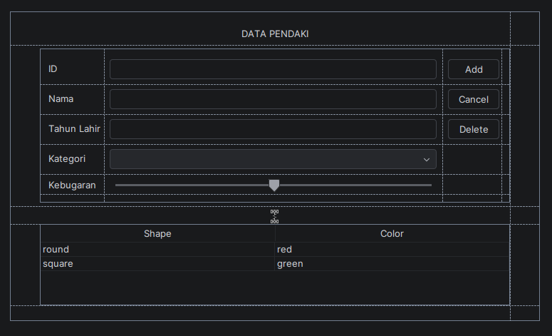
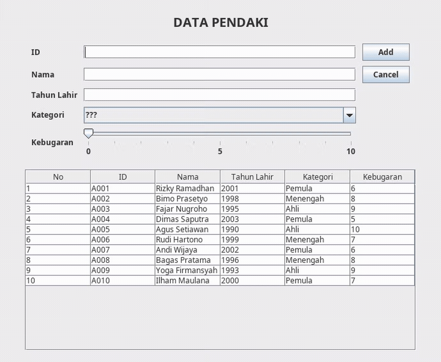
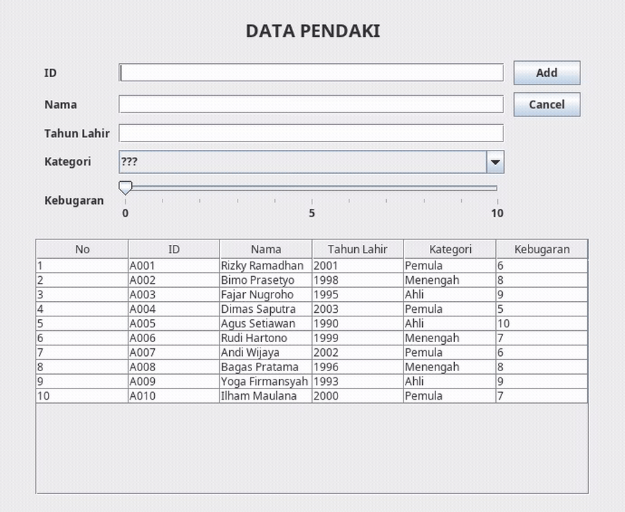
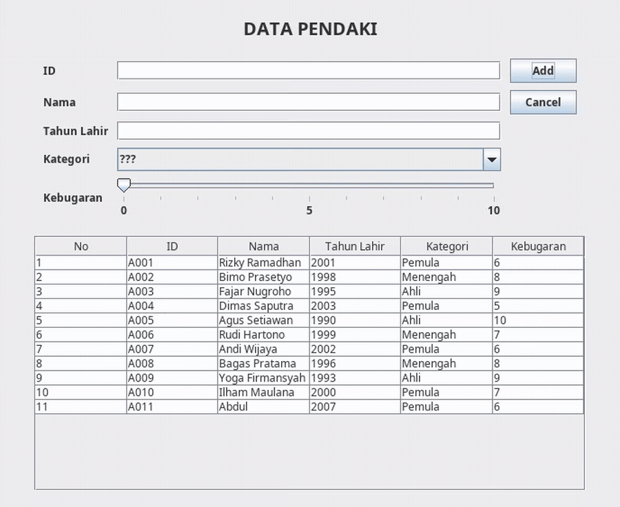
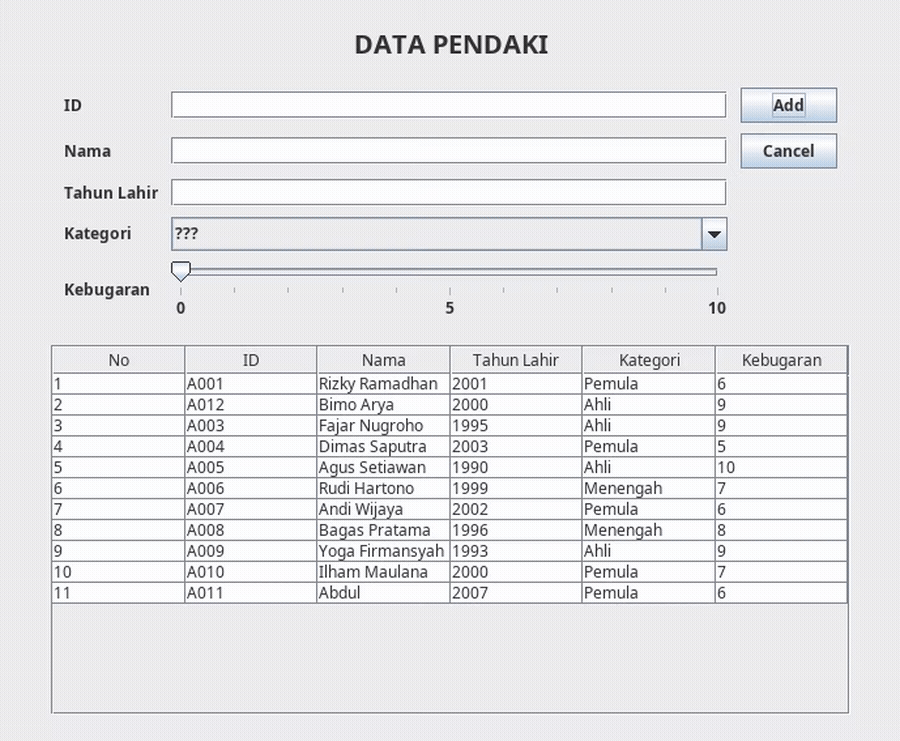
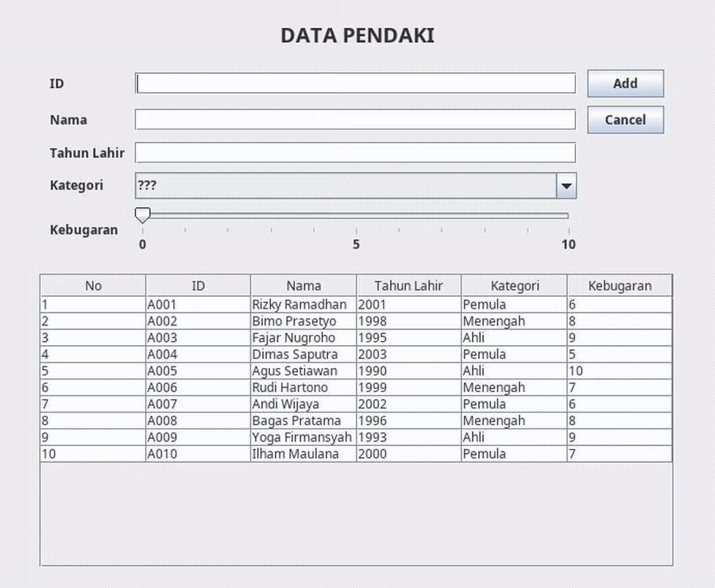
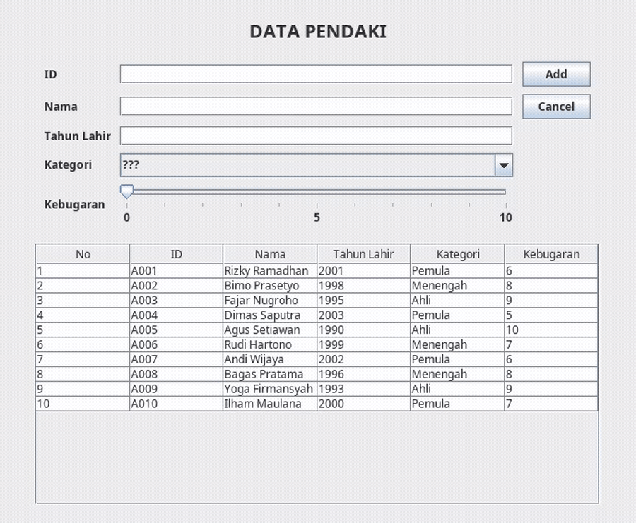
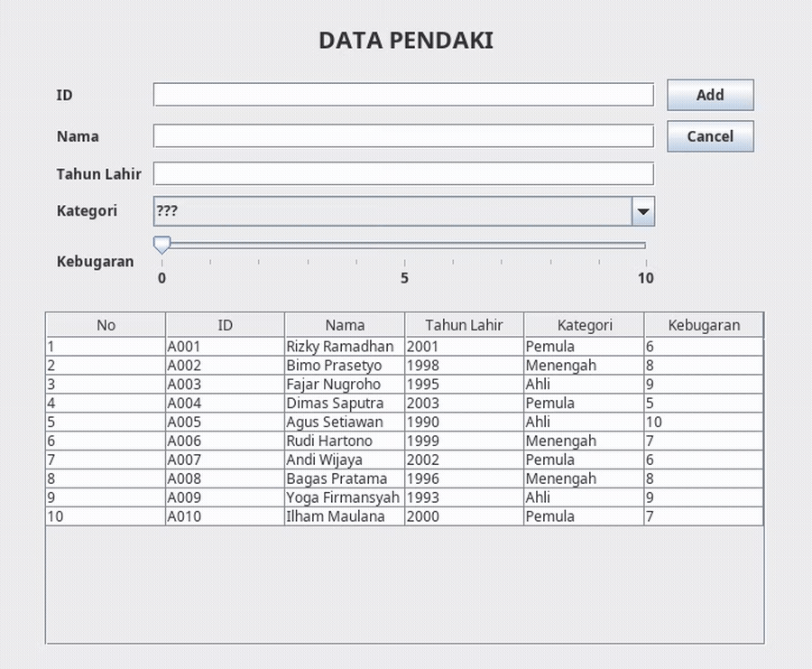

# JANJI 
Saya Muhammad Rian Anugrah dengan NIM 2507241 mengerjakan Tugas Praktikum 4 dalam mata kuliah Desain dan Pemrograman Berorientasi Objek untuk keberkahanNya maka saya tidak melakukan kecurangan seperti yang telah dispesifikasikan. Aamiin.

 

# DESIGN PROGRAM 
Program ini dibuat menggunakan Java Swing untuk mengelola data orang (PeopleData). Fitur utama meliputi: 
- Create: Menambahkan data orang baru. 
- Read: Menampilkan data orang. 
- Update: Mengedit data orang yang sudah ada. 
- Delete: Menghapus data orang. 

 

## CLASS PADA PROGRAM: 
### 1. Class Person 
Class ini berisi atribut dan method getter/setter. Berikut atribut-atributnya: 
- String id
- String nama
- int tahunLahir
- String kategori
- int kebugaran
- Constructor Person(String id, String nama, int tahunLahir, String kategori, int kebugaran)
- Getter/setter untuk setiap atribut

### 2. Class PeopleMenu extends JFrame 
Class ini berisi Graphical User Interface (GUI) dari program, berfungsi untuk mengatur GUI, serta method untuk insert, update, dan delete. 

Class ini mengatur tampilan dan logika aplikasi berbasis GUI.
Berfungsi untuk menampilkan form, menampung event handler, serta mengatur data orang dalam bentuk tabel.

<b>Komponen Utama GUI:</b>
- JTextField untuk input ID, Nama, dan Tahun Lahir
- JComboBox untuk memilih Kategori (???, Pemula, Menengah, Ahli)
- JSlider untuk memberikan nilai Kebugaran (0-10)
- JTable untuk menampilkan daftar orang
- Tombol Add/Update, Delete, dan Cancel

<b>Fungsi utama dalam class ini:</b>
- insertData() - Menambahkan orang baru ke dalam list
- updateData() - Memperbarui data orang yang dipilih
- deleteData() - Menghapus data orang setelah konfirmasi dialog
- clearForm() - Mengosongkan semua input form
- setTable() - Mengatur isi tabel berdasarkan list orang
- populateList() - Mengisi data awal orang secara default
- cekId() - Mengecek apakah ID sudah dipakai di dalam list

# ALUR PROGRAM
### 1. Tampilan Utama
Tampilan utama berisi formulir data orang yang berisi:
- ID
- Nama
- Tahun Lahir
- Kategori
- Kebugaran
- Tombol aksi Add/Update, Delete, dan Cancel.
- Tabel yang menampilkan daftar semua orang (No, ID, Nama, Tahun Lahir, Kategori, Kebugaran).

### 2. Penambahan Data Baru
User dapat menambahkan data baru dengan mengisi form data orang kemudian klik tombol aksi "Add" untuk menyimpan data ke dalam tabel.

### 3. Update Data
Saat salah satu baris tabel diklik, data orang akan muncul kembali di form input. 
Tombol "Add" otomatis berubah menjadi "Update", dan tombol "Delete" akan tampil. Setelah itu user dapat mengisi data yang ingin di update. 

### 4. Delete Data
Jika user ingin menghapus salah satu data, klik tombol "Delete" pada data yang dipilih.

Akan muncul konfirmasi dialog:
"Apakah anda yakin akan menghapus data ini?"

Jika memilih Yes, data akan dihapus dari list dan tabel. Jika memilih No, akan muncul pesan "Hapus data dibatalkan".

### 5. Cancel/Membersihkan form
Klik tombol "Cancel" untuk mengosongkan semua input form dan mengembalikan tombol ke kondisi awal (tombol "Update" kembali menjadi "Add", tombol "Delete" disembunyikan).

# ERROR HANDLING
Program ini memiliki validasi agar data yang masuk tetap benar:
- Tahun Lahir harus berupa angka. Jika diisi huruf atau dikosongkan, akan muncul pesan "Tahun harus berupa angka" dan data tidak disimpan.
- Kategori harus dipilih. Jika masih "???", akan muncul pesan "Kategori tidak boleh kosong".
- ID tidak boleh sama dengan data lain. Jika ID sudah dipakai, akan muncul pesan "ID sudah dipakai". Saat update, ID boleh tetap sama seperti sebelumnya.
- Setiap hapus data akan ada konfirmasi "Apakah anda yakin akan menghapus data ini?". Data baru dihapus jika memilih Yes.

# KOMPONEN TAMBAHAN
<b>- Kebugaran </b> 
Program ini menambahkan komponen baru berupa JSlider untuk menilai tingkat kebugaran orang (0-10).
Nilai kebugaran juga ditampilkan di tabel dan disimpan dalam atribut kebugaran di class Perso.

# DOKUMENTASI
## READ

## ADD

## UPDATE

## DELETE

## ERROR HANDLING
### Tahun Lahir bukan angka

### ID sudah dipakai

### Kategori kosong

